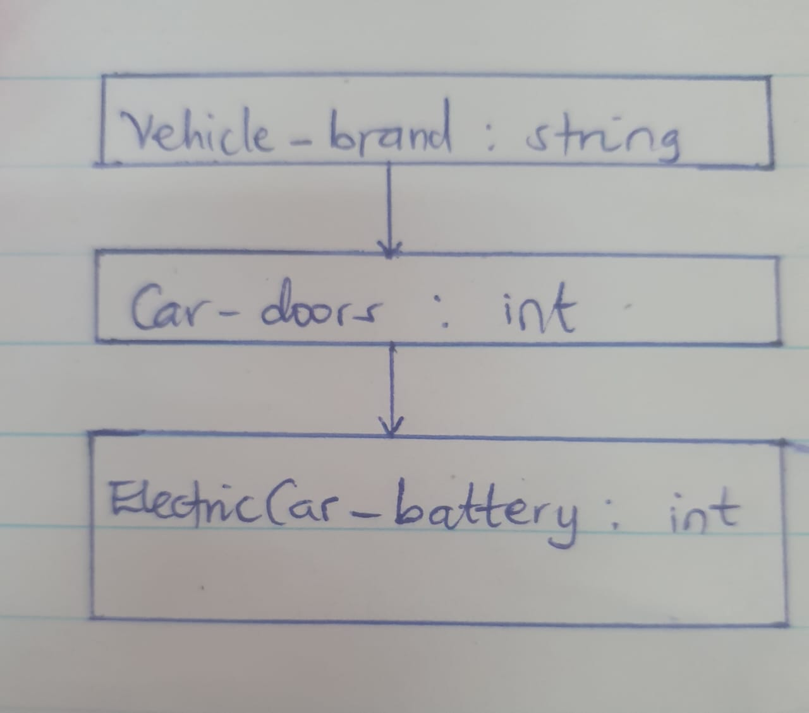
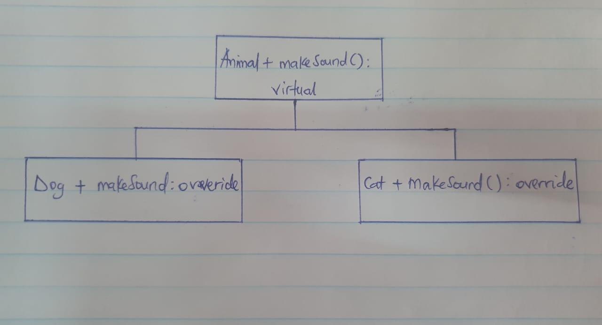

# Polymorphism Assignment

## Polymorphism in C++: Demonstrating Chained Inheritance and Runtime Polymorphism

## Introduction

I created this program to demonstrate two major concepts in object-oriented programming: chained inheritance and polymorphism. The program is designed to explain how classes can inherit one another and how a single method can behave differently depending on the object calling it. This assignment helped me understand how C++ supports modular and reusable software design.

## Objectives

The objectives of this assignment were to:

- demonstrate multilevel inheritance using a vehicle hierarchy
- explain polymorphism using animals as examples
- understand the difference between inheritance and dynamic method dispatch
- implement reusable and organized object-oriented code

## 1. Chained Inheritance

The first part of the program demonstrates multilevel inheritance with a vehicle example. The hierarchy is structured as follows:

- `Vehicle` is the base class
- `Car` inherits from `Vehicle`
- `ElectricCar` inherits from `Car`

This relationship helps me show how properties and methods can pass from a parent class to a child class and then to a grandchild class.

### Diagram for Chained Inheritance

### Implementation

I started by creating a `Vehicle` class with a protected member called `brand`. I then created a `Car` class that adds another member, `numDoors`, and a method to display the vehicle details. Finally, I created an `ElectricCar` class that adds the `batteryCapacity` attribute and displays the complete information for the object.

I used this implementation to show how inheritance allows me to build on previous code rather than rewriting the same attributes and methods again. This improves readability, maintainability, and reuse in object-oriented programming.

## 2. Runtime Polymorphism

The second section of the program demonstrates dynamic polymorphism. I used an animal hierarchy to show how different derived classes can override the same method while using a base class pointer.

The class structure is:

- `Animal` is the base class
- `Dog` inherits from `Animal`
- `Cat` inherits from `Animal`

The base class method `makeSound()` is declared as `virtual`, allowing the compiler to bind the function call at runtime rather than compile time.

### Diagram for Polymorphism

### Implementation

I created a base class `Animal` with a virtual function named `makeSound()`. I then overrode this method in both the `Dog` and `Cat` classes. In the `main()` function, I used pointers of type `Animal*` to point to `Dog` and `Cat` objects, and I called `makeSound()` through those pointers.

This implementation demonstrates the concept of runtime polymorphism clearly: the same method call produces different outputs depending on the type of object being referenced. In other words, one method name can represent multiple behaviors.

## Characteristics of the Program

This program has several important characteristics:

- Inheritance: Classes inherit properties and methods from parent classes.
- Reusability: Common code is written once in the base classes and reused in derived classes.
- Encapsulation: Data is protected and behavior is handled through methods.
- Polymorphism: A single interface can produce different outputs depending on the object.
- Flexibility: The program can be extended by adding more classes without changing existing code structure.
- Readability: The code is organized into meaningful sections so the logic is easy to follow.

## Why This Program Is Important

This program is important because it illustrates how C++ makes object-oriented programming practical and powerful. It shows that inheritance reduces duplication and that polymorphism allows programs to be more flexible and scalable. These features are widely used in software development for creating robust and maintainable systems.

## Conclusion

In conclusion, I created this C++ assignment to explain and demonstrate the principles of chained inheritance and runtime polymorphism. It helped me understand how classes can be organized into hierarchies and how a common method can behave differently for different objects. The use of real-world examples such as vehicles and animals made the concepts easier to understand and apply.

I believe this program successfully illustrates the value of object-oriented programming in designing efficient, reusable, and clean code.
